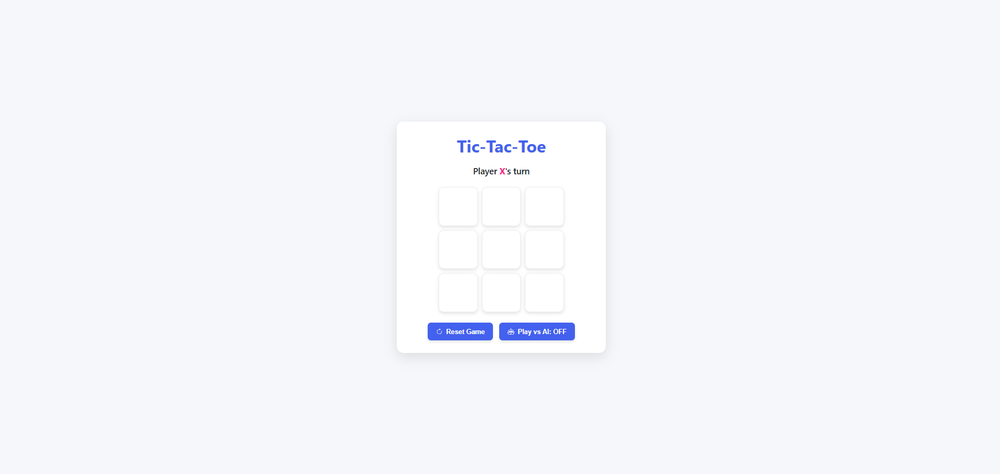
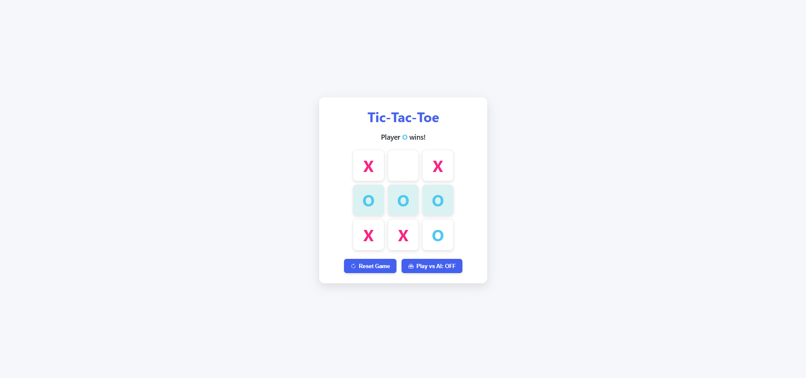

# Tic-Tac-Toe

A browser-based Tic-Tac-Toe game with a clean, simple interface. Play on a 3 × 3 grid, follow the current turn, and reset the board to start a new game. The interface also includes an option to toggle playing against the AI.

## Screenshots

### Game screen

### Game result

## Features

- Interactive 3 × 3 Tic-Tac-Toe board
- Displays whose turn it is
- Shows the winner when a player wins
- Reset Game control to start over
- Toggle for playing against the AI

## Built With

- HTML
- CSS
- JavaScript

## Run Locally

1. Clone or download this repository.
2. Open `index.html` in your web browser.

No additional server is required for a basic local run.

